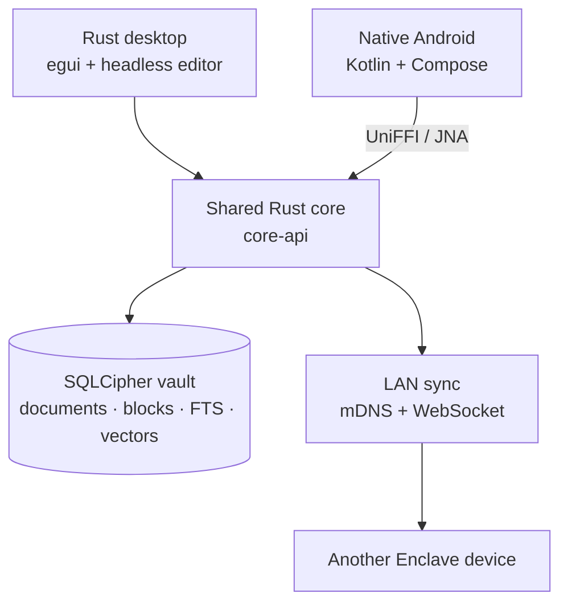

<p align="center">
  <br>
  <picture>
    <source media="(prefers-color-scheme: dark)" srcset="docs/brand/lockup-dark.svg">
    
  </picture>
  <br>
</p>

<h3 align="center">A private, local-first knowledge base for desktop and Android.</h3>

<p align="center">
  Encrypted at rest. Synced directly over your own Wi-Fi. No cloud, no account, no telemetry.
</p>

<p align="center">
  <a href="https://pranesh-selvaraj.github.io/Enclave/"><strong>Website</strong></a> ·
  <a href="#features">Features</a> ·
  <a href="#architecture">Architecture</a> ·
  <a href="#build-and-test">Build</a> ·
  <a href="#documentation">Docs</a> ·
  <a href="https://github.com/Pranesh-Selvaraj/Enclave/issues">Issues</a>
</p>

<p align="center">
  <a href="https://github.com/Pranesh-Selvaraj/Enclave/actions/workflows/desktop.yml"></a>
  <a href="https://github.com/Pranesh-Selvaraj/Enclave/actions/workflows/android-app.yml"></a>
  <a href="LICENSE"></a>
  
  
</p>

---

## At a glance

| | |
| --- | --- |
| **2 native apps** | Rust desktop and Kotlin/Compose Android, sharing one core |
| **1 encrypted vault** | SQLCipher, AES-256-CBC + HMAC-SHA512, Argon2id key derivation |
| **0 cloud services** | No account, no telemetry, no Enclave server |
| **76 core tests · 19 desktop tests** | Contract fixtures, crypto, storage, editor and worker flows |
| **v1 vault · v1 block JSON · v3 sync** | Versioned, fixture-tested, forward-migrated |
| **12-word recovery** | BIP39 mnemonic; the only copy of the key is yours |
| **LAN-only** | mDNS discovery, WebSocket transport, XChaCha20-Poly1305 frames |
| **MIT** | Fully open source, including the editor engine |

> **Project status:** the native Android app is the current reference build; the Rust desktop is under active development. The website below is the best way to see the product.

<p align="center">
  <a href="https://pranesh-selvaraj.github.io/Enclave/"><strong>Take the interactive product tour →</strong></a>
</p>

## Choose your path

| I want to… | Start here |
| --- | --- |
| **Use Enclave** | [Website tour](https://pranesh-selvaraj.github.io/Enclave/) · [Features](#features) · [Security](#security) |
| **Build or embed it** | [Architecture](#architecture) · [Contract](docs/CONTRACT.md) · [Build and test](#build-and-test) |
| **Contribute** | [Open issues](https://github.com/Pranesh-Selvaraj/Enclave/issues) · [Contributing](CONTRIBUTING.md) · [Decisions](docs/decisions/README.md) |
| **Audit the model** | [Security policy](SECURITY.md) · [Contract](docs/CONTRACT.md) · [History](docs/HISTORY.md) |

<details>
<summary><strong>What is inside a vault?</strong></summary>

The vault is one SQLCipher-encrypted SQLite file containing documents, blocks, folders, settings and derived search data. The master key is derived from your password/recovery phrase and exists in memory only while unlocked.

Sync carries **documents, blocks and folders**. Full-text indexes, embeddings and device settings stay local; the encryption key never leaves the device. The only optional outbound traffic is an AI provider you explicitly configure.

</details>

## Why Enclave

- **Your notes never leave your devices.** The vault is encrypted before it touches disk. Sync is peer-to-peer on your LAN, not a relay.
- **Native, not a web app in a window.** A Rust desktop and a Kotlin/Compose Android app, both on one audited Rust core. No browser engine, no JavaScript runtime, no C ABI.
- **A real workspace, not a text box.** Rich text, tables, tasks, code, images, databases, whiteboards, a backlink graph and split view.
- **AI on your terms.** Opt-in, local-first retrieval, explicit remote consent, citations, and agent tools that the app executes after approval — not the model.
- **Open source end to end.** MIT core, fixtures and editor engine. The security model is documented; the vault format is versioned.

## Contents

- [Choose your path](#choose-your-path)
- [Features](#features)
- [For users](#for-users)
- [For developers](#for-developers)
- [Architecture](#architecture)
- [Tech stack](#tech-stack)
- [Platforms](#platforms)
- [Editor](#editor)
- [Whiteboard, databases and graph](#whiteboard-databases-and-graph)
- [Sync](#sync)
- [Local AI](#local-ai)
- [Security](#security)
- [Build and test](#build-and-test)
- [Repository layout](#repository-layout)
- [Documentation](#documentation)
- [Contributing](#contributing)
- [License](#license)

## Features

### Vault and account

- One encrypted vault per install, created with a password and a 12-word recovery phrase shown once.
- Unlock with the password or the recovery phrase; change the password without re-encrypting the vault.
- Auto-lock, manual lock, encrypted backup and same-vault restore.
- No account, no Enclave server, no telemetry. The app works fully offline.

### Notes and knowledge

- Notes with headings, rich text, lists, tasks, quotes, code, tables, images, files and links.
- Folders, tags, favourites, search, trash and archive.
- Page links, backlinks, mentions, page embeds and a table of contents.
- Built-in and user-created templates.
- Android layouts (List, Gallery, Cards, Icons), sorting and one-handed search.
- Desktop sidebar, split view and command palette.

### Editor

- Block-based ProseMirror/TipTap JSON document model.
- Marks: bold, italic, strike, inline code and links.
- Nested lists, tasks, quotes, callouts, toggles, dividers and fenced code.
- Tables with headers and cell editing.
- Images, PDFs and arbitrary files stored in the vault.
- Slash commands, bubble formatting menu, block drag handles and block menu.
- Markdown source, Markdown/HTML export, Markdown import and encrypted whole-vault backup.
- Undo/redo, autosave and a native text surface that respects the platform's IME.

### Whiteboard, databases and graph

- **Whiteboard:** infinite canvas, stickies, shapes, arrows, text, frames, page embeds, mind maps, presentation mode and PNG export.
- **Databases:** typed rows, multiple column types, table/kanban/list/gallery/timeline views, grouping, sorting, filters and linked databases.
- **Graph:** backlink graph with zoom, pan and page focus.
- **Split view:** two pages side by side, both autosaving.

### Android and desktop integration

- **Android:** home-screen widgets, pinned note, quick capture, Quick Settings tile, launcher shortcuts and share target; foreground sync service; Keystore-wrapped widget cache; SAF backup; release-build screenshot protection.
- **Desktop:** native menus, keyboard shortcuts, tray quick capture, wallpaper-style widget, themes, accent colours, density, fonts and OLED mode.
- **Updates:** opt-in only; SHA-256 and a pinned Ed25519 signature are verified before any installer can run.

## For users

Start with the [website](https://pranesh-selvaraj.github.io/Enclave/) for the interactive product tour, then read [SECURITY.md](SECURITY.md) for the data model.

- **Private by default.** The vault is encrypted at rest; the encryption key exists in memory only while unlocked.
- **Offline by default.** Create, edit and organise pages with no network. Sync is an enhancement, not a requirement.
- **Yours for the long term.** The vault is a SQLite file you can back up, restore and read with an open format. The recovery phrase is the root of access.
- **No lock-in.** Markdown and HTML export per page; encrypted whole-vault backup and restore.

## For developers

Enclave is deliberately small at the boundaries:

- **One shared core.** [`core/`](core/) owns the vault, crypto, storage, search, sync and updates. Android uses UniFFI; the desktop depends on `core-api` as a Rust crate.
- **No webview, no C ABI, no JavaScript UI runtime.** The desktop editor engine is in-house and headless; the Android editor is Kotlin/Compose over the same JSON contract.
- **The contract is executable.** Vault schema, block JSON and sync frames have golden fixtures; `cargo test --manifest-path core/Cargo.toml` is the gate.
- **Everything is documented.** ADRs explain the decisions; [`docs/CONTRACT.md`](docs/CONTRACT.md) explains the four versioned surfaces; [`docs/STATUS.md`](docs/STATUS.md) is the living handoff.
- **Build in minutes.** Commands are in [Build and test](#build-and-test); CI runs the core, desktop and native Android jobs.

## Architecture



The core is the only implementation of cryptography, storage, the block schema, search and sync. It exposes one shell-agnostic API. The desktop links it directly; Android consumes it through typed UniFFI bindings. Neither shell implements vault logic.

Every page is a block document stored as ProseMirror/TipTap JSON. The same document opens on desktop, Android and historical vaults. Sync exchanges documents, blocks and folders with document-level last-write-wins.

## Tech stack

| Layer | Technology |
| --- | --- |
| **Core** | Rust: `core-db` (SQLite + SQLCipher, FTS5, `sqlite-vec`), `core-network` (mDNS + WebSocket), `core-api` (shell-agnostic API, UniFFI) |
| **Desktop** | Rust, `eframe`/`egui`, an in-house headless block engine |
| **Android** | Kotlin, Jetpack Compose, Glance widgets, JNA + UniFFI |
| **Storage** | SQLite + SQLCipher (AES-256-CBC + HMAC-SHA512) |
| **Keys** | BIP39 12-word mnemonic; Argon2id (64 MiB, 3 passes, 4 lanes); AES-256-GCM for `vault.key` |
| **Sync** | mDNS discovery, WebSocket, HMAC-SHA256 auth, XChaCha20-Poly1305 sealed frames |
| **Search** | FTS5 + `sqlite-vec` ANN inside the encrypted database |
| **AI** | Opt-in local embeddings/RAG; OpenAI-compatible local or remote providers; app-enforced agent tools |
| **Website** | Static HTML/CSS/JS assembled by a Node script; GitHub Pages |

## Platforms

| Platform | Target |
| --- | --- |
| **Android** (arm64) | Native Kotlin + Compose app; current reference build |
| **Linux** (x86_64) | Native Rust desktop; `.deb` / `.AppImage` packaging |
| **Windows** (x86_64) | Native Rust desktop; `.msi` / NSIS packaging |
| **macOS** (Apple Silicon) | Native Rust desktop; `.dmg` packaging and notarisation |
| **iOS** | **Roadmap** — a native iOS app is planned on the same Rust core; the versioned contract is designed to support it. See the [roadmap](https://pranesh-selvaraj.github.io/Enclave/#roadmap). |

## Editor

Every page toggles between **Paper** (documents) and **Whiteboard** (infinite canvas).

### Paper blocks

| Block | What it does |
| --- | --- |
| Text, headings 1–3 | Base document flow with a slash menu and block types |
| Bullet, numbered and task lists | Nested lists and task toggles that write through the core |
| Quote, callout, toggle, divider | Structural blocks for notes and documents |
| Code block | Monospace editing with a language label |
| Table | Header row and editable cells |
| Image, PDF, file | Stored in the vault, previewed inline and opened with the system viewer |
| Bookmark | A URL card |
| Page embed | An inline card for another page |
| Database and linked database | Typed rows with table/kanban/list/gallery/timeline views |
| Template | Start from a checklist, meeting notes, project plan, journal, book notes or your own template |

Formatting lives on the selection: bold, italic, strike, inline code and links. The block handle duplicates, removes, cuts and copies blocks. Page links, mentions and backlinks connect the vault; the outline panel tracks the current heading.

### Editor chrome

- Command palette (`Ctrl/Cmd+K`), new page and sidebar toggle.
- Page emoji, cover, tags and favourite state.
- Created/modified time and word count.
- Delete-to-trash with undo.
- Markdown source toggle and Markdown/HTML export.
- Ask-AI panel with sources and citations.

## Whiteboard, databases and graph

The whiteboard is an infinite canvas for thinking in space: stickies, shapes, arrows, text, frames, page embeds and mind maps (Tab creates a child node). Frames can be presented as a sequence, and the canvas exports to PNG. The graph view maps page links and backlinks and lets you travel through the vault visually.

## Sync

Sync is **LAN-only and peer-to-peer**:

1. Both devices advertise over mDNS (`_enclave._tcp.local`) or connect to a manually entered `host:port`.
2. They open a WebSocket and perform a challenge-response handshake using a key derived from the vault seed phrase.
3. After authentication, every frame is sealed with XChaCha20-Poly1305 under a per-session key.
4. Peers exchange a digest, request what they need, send documents/blocks/folders, merge with document-level last-write-wins and acknowledge.
5. The Android foreground service keeps sync alive with a visible notification; the desktop shows peer and last-sync status.

No relay, no cloud, no account. Devices on the same Wi-Fi see only ciphertext and an mDNS name. Sync assumes a network you control; do not sync across an untrusted network.

## Local AI

The AI layer is **opt-in and off by default**. It is designed around the vault, not a cloud service:

- **Retrieval:** blocks are embedded locally on save and stored in the encrypted database; questions retrieve the most relevant pages with vector + full-text search.
- **Answers:** a local OpenAI-compatible server (Ollama, llama.cpp/llama-server, LM Studio, vLLM) or an explicitly configured remote provider. Remote use shows the context being sent and requires consent.
- **Citations:** answers link back to the pages they used.
- **Agent behavior:** the model can propose actions, but the app executes only allowlisted tools, asks before writes, and never gives the model direct access to the vault, shell, filesystem or network.
- **Privacy:** no telemetry, no prompt/note logging and no vault key in the AI path.

See [SECURITY.md](SECURITY.md) for the data boundary.

## Security

- **At rest:** SQLCipher with AES-256-CBC and HMAC-SHA512. The master key comes from a BIP39 mnemonic through Argon2id and exists in memory only while unlocked.
- **Key file:** `vault.key` stores the mnemonic re-encrypted with Argon2id (fresh salt) and AES-256-GCM under the password. It is useless without that password.
- **In transit:** mutually authenticated, encrypted LAN frames. Only devices with the same vault key can join; a wrong-key peer is rejected before any data.
- **Shell isolation:** desktop and Android own windows and input. Crypto, storage and sync stay in the core; no plaintext key material crosses the UI boundary.
- **Updates:** opt-in only. Downloads are checked against GitHub's size and SHA-256 and a pinned Ed25519 signature before an installer can run.
- **No cloud:** the only optional outbound traffic is the AI provider you configure.

## Build and test

### Prerequisites

- **Rust** 1.95+ ([rustup.rs](https://rustup.rs)); the core builds on older stable, the desktop uses eframe/egui 0.37.
- **Linux desktop:** `libxkbcommon-dev libwayland-dev libx11-dev libxcursor-dev libxrandr-dev libxi-dev libssl-dev`.
- **Android:** JDK 21, Android SDK platform 36, build-tools 36.0.0, NDK 29.0.13846066, `cargo-ndk`, and the Android Rust targets.
- **Node.js** 24+ only for the static homepage.

### Core

```bash
source ~/.enclave-dev/env.sh
cargo test --manifest-path core/Cargo.toml
```

### Rust desktop

```bash
cargo test --locked --manifest-path apps/desktop/Cargo.toml
cargo clippy --locked --manifest-path apps/desktop/Cargo.toml --all-targets -- -D warnings
cargo fmt --manifest-path apps/desktop/Cargo.toml --check
cargo build --locked --manifest-path apps/desktop/Cargo.toml
cargo run --manifest-path apps/desktop/Cargo.toml
```

The desktop uses the same app-data directory as earlier Enclave builds (`com.enclave.app`) so it can open an existing vault. Set `ENCLAVE_APP_DIR` to isolate development. On WSL2/WSLg use `WGPU_BACKEND=gl LIBGL_ALWAYS_SOFTWARE=1`; see [`apps/desktop/README.md`](apps/desktop/README.md).

### Android

```bash
source ~/.enclave-dev/android-env.sh
./apps/android/scripts/build-core.sh
cd apps/android && ./gradlew assembleDebug testDebugUnitTest
```

Release signing uses `scripts/android-sign.sh`; the keystore environment is documented in the workflow. See [`apps/android/README.md`](apps/android/README.md).

### Website

```bash
node scripts/build-site.mjs
python3 -m http.server 8080 -d site-dist
```

### Release pre-flight

```bash
bash scripts/release-check.sh
```

It checks the desktop Cargo version, the Android `version.properties`, the CHANGELOG and Android `versionCode` ordering before a tag is cut.

## Repository layout

```
enclave/
├── core/                           # Shared Rust core, its own Cargo workspace
│   ├── core-db/                    # SQLCipher storage, FTS5, sqlite-vec, sync merge
│   ├── core-network/               # mDNS + WebSocket transport, handshake, sealed frames
│   └── core-api/                   # Shell-agnostic API; UniFFI for Android; Rust for desktop
├── apps/
│   ├── desktop/                    # Rust desktop: egui shell + headless block engine
│   └── android/                    # Native Android: Kotlin + Jetpack Compose
├── docs/                           # Contract, decisions, plans, status, history, brand
├── site/                           # Static homepage
├── scripts/                        # Site build, Android signing, release checks
└── .github/workflows/              # Desktop, Android and homepage CI
```

## Documentation

- [Website](https://pranesh-selvaraj.github.io/Enclave/) — interactive tour, roadmap and downloads.
- [CONTRIBUTING.md](CONTRIBUTING.md) — development, validation and release rules.
- [SECURITY.md](SECURITY.md) — the security model and vulnerability reporting.
- [docs/CONTRACT.md](docs/CONTRACT.md) — vault schema, block JSON, sync protocol and app boundary.
- [docs/STATUS.md](docs/STATUS.md) — current state and next work.
- [docs/HISTORY.md](docs/HISTORY.md) — project timeline and stack changes.
- [docs/decisions/](docs/decisions/README.md) — architecture decision records.
- [docs/plans/](docs/plans/) — native app plan and desktop feature work.
- [docs/brand/](docs/brand/README.md) — logo, mark, wordmark, fonts and usage.
- [site/](site/README.md) — the public homepage.

## Contributing

Contributions are welcome. Start with an issue, branch from `main`, keep the change focused, and run the validation commands above. The contract fixtures, vault lifecycle and editor engine are test-gated; a change to `core/` must not break either native app.

- [Open issues](https://github.com/Pranesh-Selvaraj/Enclave/issues)
- [Contributing guide](CONTRIBUTING.md)
- [Security policy](SECURITY.md)

## License

MIT. See [LICENSE](LICENSE).
