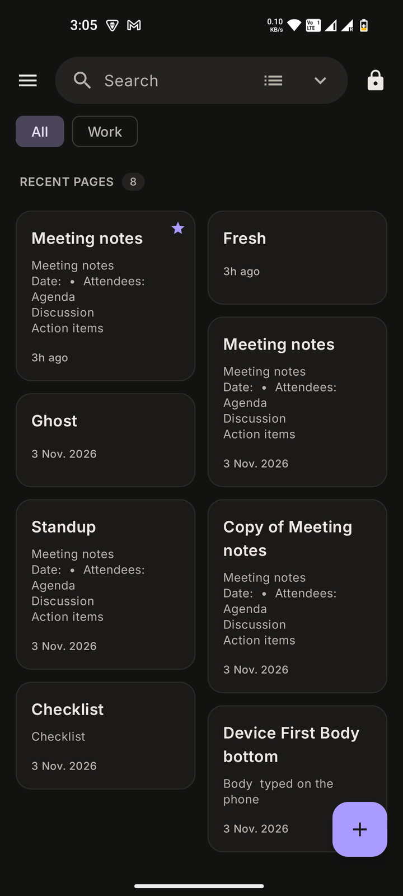
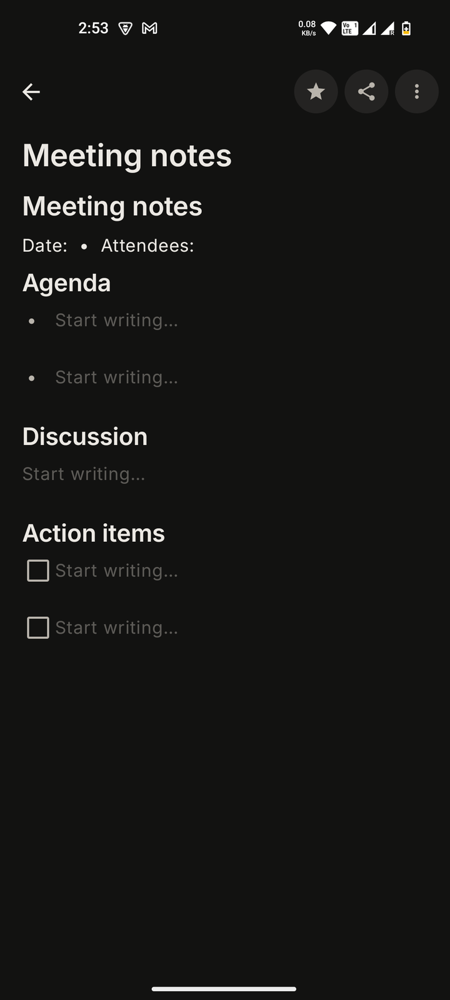
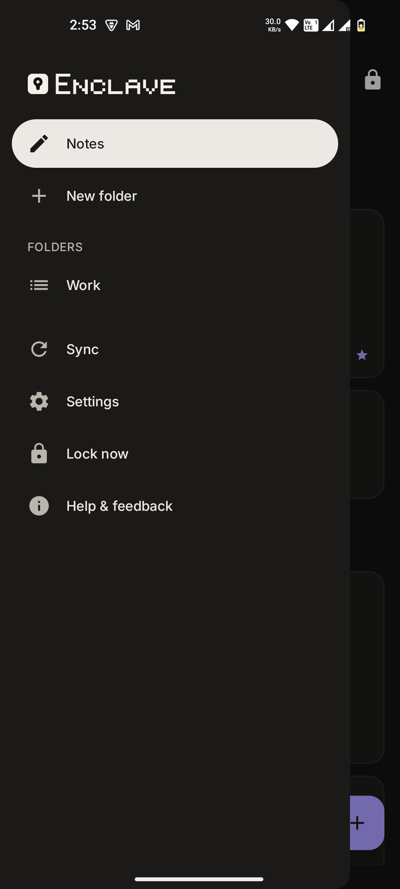

<p align="center">
  <br>
  <picture>
    <source media="(prefers-color-scheme: dark)" srcset="docs/brand/lockup-dark.svg">
    
  </picture>
  <br>
  <br>
</p>

> **A private, local-first knowledge base for desktop and Android.**
>
> Encrypted at rest. Synced directly over your own Wi-Fi. No cloud, no account, no telemetry.

Enclave is a notes and knowledge app for people who do not want their writing in someone else's cloud. Pages, folders, tasks, tables, whiteboards and the links between them live in a single encrypted vault on your device. When two devices are on the same network they find each other and sync directly, peer to peer. The optional AI assistant is opt-in and designed to keep retrieval local.

The apps are native: a Rust desktop and a Kotlin/Compose Android app, both on the same Rust core. There is no browser engine and no JavaScript runtime in the product. The desktop is under active development; the Android app is the current reference implementation.

## Contents

- [Features](#features)
- [How it works](#how-it-works)
- [Tech stack](#tech-stack)
- [Platforms](#platforms)
- [Editor](#editor)
- [Whiteboard and graph](#whiteboard-and-graph)
- [Sync](#sync)
- [Local AI](#local-ai)
- [Security](#security)
- [Build and test](#build-and-test)
- [Repository layout](#repository-layout)
- [Screenshots](#screenshots)
- [Documentation](#documentation)
- [License](#license)

## Features

### Your vault

- One encrypted vault per install. Create it with a password and save the 12-word recovery phrase shown once.
- Unlock with the password or the recovery phrase; change the password without re-encrypting the whole vault.
- Auto-lock, manual lock, encrypted backup and restore. A restored backup must belong to the same vault.
- Everything is stored locally. There is no account, no sync server and no Enclave infrastructure to trust.

### Notes and knowledge

- Notes with headings, rich text, lists, tasks, quotes, code, tables, images, files and links.
- Folders, tags, favourites, search and a trash/archive flow.
- Page links and backlinks, mentions, page embeds and a table of contents.
- Templates for recurring pages, plus your own templates.
- Multiple note layouts on Android (List, Gallery, Cards, Icons), sorting one-handed from a search pill.
- A desktop workspace with a sidebar tree, split view and a command palette.

### Editing

- Block-based document model compatible with ProseMirror/TipTap JSON.
- Marks: bold, italic, strike, inline code and links.
- Nested lists, task checklists, blockquotes, callouts, toggles, dividers and fenced code blocks.
- Tables with header rows and cell editing.
- Images, PDFs and arbitrary files stored inside the vault.
- Slash commands, a bubble formatting menu, block drag handles and a block menu.
- Markdown source view, Markdown/HTML export, Markdown import and encrypted whole-vault backup.
- Undo/redo, debounced autosave and a native editor surface that respects the platform's input methods.

### Whiteboard, databases and graph

- **Whiteboard**: infinite canvas with sticky notes, rectangles, ellipses, arrows, text, frames, page embeds and mind maps; presentation mode and PNG export.
- **Databases**: typed tables with multiple column types and table, kanban, list, gallery and timeline views; grouping, sorting and filters; linked databases.
- **Graph**: the backlink graph, with zoom, pan and page focus.
- **Split view**: two pages side by side with autosaving panes.

### Android

- A notes-first Compose app with a drawer, search pill, four layouts and long-press actions.
- Home-screen widgets: notes list, pinned note and quick capture; a Quick Settings tile, launcher shortcuts and a share target.
- Foreground sync service with a visible notification; Keystore-wrapped widget cache.
- SAF backup/restore, theme and accent settings, editor text size/page width, auto-lock and an opt-in update check.
- Release builds block screenshots and recents previews.

### Desktop

- Native Rust window, menus, keyboard shortcuts and a focused editor shell.
- Tray/quick-capture and a wallpaper-style widget are part of the desktop surface.
- Themes, accent colours, background styles, corner styles, density, fonts and OLED mode.
- Signed installers and verified updates; the app never checks for updates unless you opt in.

### AI, on your terms

- Opt-in and off by default.
- Local embeddings and retrieval by default; remote providers need explicit consent.
- Answers cite the pages they used.
- Agent-style actions are proposed by the model and executed by the app after approval; the model gets no direct vault, shell or network access.
- No telemetry and no logging of prompts or note contents.

## How it works

```
┌──────────────────────────┐        ┌──────────────────────────┐
│ Rust desktop             │        │ Native Android           │
│ egui shell + editor      │        │ Kotlin + Jetpack Compose │
└────────────┬─────────────┘        └────────────┬─────────────┘
             │ direct Rust crate                 │ UniFFI / JNA
             └──────────────────┬────────────────┘
                                ▼
                 ┌─────────────────────────────┐
                 │ Shared Rust core            │
                 │ vault · crypto · storage    │
                 │ search · sync · updates     │
                 └──────────────┬──────────────┘
                                │
              ┌─────────────────┴─────────────────┐
              ▼                                   ▼
     SQLCipher-encrypted DB               mDNS + WebSocket
     (AES-256-CBC + HMAC-SHA512)          (auth + XChaCha20-Poly1305)
```

The core is the only implementation of cryptography, storage, the block schema, search and sync. It exposes one shell-agnostic API. Android consumes it through typed UniFFI bindings; the Rust desktop links it as a normal crate. Neither shell implements its own vault logic.

The document format is ProseMirror/TipTap JSON stored as a block in the vault, so desktop, Android and historical vaults all read the same content. The sync protocol ships documents, blocks and folders with document-level last-write-wins.

## Tech stack

| Layer | Technology |
| --- | --- |
| **Core** | Rust: `core-db` (SQLCipher, FTS5, `sqlite-vec`), `core-network` (mDNS + WebSocket), `core-api` (shell-agnostic API, UniFFI) |
| **Desktop** | Rust, `eframe`/`egui`, an in-house headless block engine over ProseMirror JSON |
| **Android** | Kotlin, Jetpack Compose, Glance widgets, JNA + UniFFI |
| **Storage** | SQLite + SQLCipher (AES-256-CBC with HMAC-SHA512) |
| **Keys** | BIP39 12-word mnemonic, Argon2id (64 MiB, 3 passes, 4 lanes), AES-256-GCM for `vault.key` |
| **Sync** | mDNS discovery, WebSocket transport, HMAC-SHA256 auth, XChaCha20-Poly1305 sealed frames |
| **Search** | FTS5 + `sqlite-vec` ANN index inside the encrypted database |
| **AI** | Opt-in local embeddings/RAG; OpenAI-compatible local or remote providers; app-enforced agent tools |
| **Homepage** | Static HTML/CSS/JS assembled by a Node script; GitHub Pages |

## Platforms

| Platform | Target |
| --- | --- |
| **Android** (arm64) | Native Kotlin + Jetpack Compose app; current reference build |
| **Linux** (x86_64) | Native Rust desktop; `.deb` / `.AppImage` packaging |
| **Windows** (x86_64) | Native Rust desktop; `.msi` / NSIS packaging |
| **macOS** (Apple Silicon) | Native Rust desktop; `.dmg` packaging and notarisation |
| **iOS** | Not currently targeted; the versioned contract does not preclude it |

The desktop is under active development; packaging and update orchestration live in the desktop release work.

## Editor

Enclave pages are block documents. Every page can switch between **Paper** (documents) and **Whiteboard** (infinite canvas).

### Paper blocks

| Block | What it does |
| --- | --- |
| Text, headings 1–3 | The base document flow, with a slash menu and block types |
| Bullet, numbered and task lists | Nested lists and task toggles that write through the core |
| Quote, callout, toggle, divider | Structural blocks for notes and documents |
| Code block | Monospace editing with a language label |
| Table | Header row and editable cells |
| Image, PDF, file | Stored in the vault, previewed inline and opened with the system viewer |
| Bookmark | A URL card |
| Page embed | An inline card for another page |
| Database and linked database | Typed rows with table/kanban/list/gallery/timeline views |
| Template | Start a page from a checklist, meeting notes, project plan, journal or book notes |

Formatting lives on the selection: bold, italic, strike, inline code and links. The block handle duplicates, removes, cuts and copies blocks. Page links, mentions and backlinks connect the vault; the outline panel tracks the current heading.

### Editor chrome

- Command palette (`Ctrl/Cmd+K`), new page and sidebar toggle.
- Page emoji, cover, tags and favourite state.
- Created/modified time and word count.
- Delete to trash with an undo window.
- Markdown source toggle and Markdown/HTML export.
- Ask-AI panel with sources and citations.

### Whiteboard and graph

The whiteboard is an infinite canvas for thinking in space: stickies, shapes, arrows, text, frames, page embeds and mind maps (Tab creates a child node). Frames can be presented as a sequence, and the canvas exports to PNG. The graph view maps page links and backlinks and lets you travel through the vault visually.

## Sync

Sync is **LAN-only and peer-to-peer**:

1. Both devices advertise over mDNS (`_enclave._tcp.local`) or connect to a manually entered `host:port`.
2. They open a WebSocket and perform a challenge-response handshake using a key derived from the vault seed phrase.
3. After authentication, every frame is sealed with XChaCha20-Poly1305 under a per-session key.
4. Peers exchange a digest, request what they need, send documents/blocks/folders, merge with document-level last-write-wins and acknowledge.
5. The foreground Android service keeps sync alive with a visible notification; the desktop shows peer and last-sync status.

No relay, no cloud, no account. Devices on the same Wi-Fi see only ciphertext and an mDNS name. Sync assumes a network you control; do not sync across an untrusted network.

## Local AI

The AI layer is **opt-in and off by default**. It is designed around the vault, not a cloud service:

- **Retrieval**: blocks are embedded locally on save and stored in the encrypted database; questions retrieve the most relevant pages with vector + full-text search.
- **Answers**: a local OpenAI-compatible server (Ollama, llama.cpp/llama-server, LM Studio, vLLM) or an explicitly configured remote provider. Remote use shows the context being sent and requires consent.
- **Citations**: answers link back to the pages they used.
- **Agent behavior**: the model can propose actions, but the app executes only allowlisted tools, asks before writes, and never gives the model direct access to the vault, shell, filesystem or network.
- **Privacy**: no telemetry, no prompt/note logging, and no vault key in the AI path.

See [SECURITY.md](SECURITY.md) for the data boundary.

## Security

- **At rest**: SQLCipher with AES-256-CBC and HMAC-SHA512. The master key is derived from a BIP39 mnemonic through Argon2id and exists in memory only while unlocked.
- **Key file**: `vault.key` stores the mnemonic re-encrypted with Argon2id (fresh salt) and AES-256-GCM under the password. It is useless without that password.
- **In transit**: mutually authenticated, encrypted LAN frames. Only devices with the same vault key can join; a wrong-key peer is rejected before any data.
- **Shell isolation**: desktop and Android own windows and input. Crypto, storage and sync stay in the core; no plaintext key material crosses the UI boundary.
- **Updates**: opt-in only. Downloads are checked against GitHub's size and SHA-256 and a pinned Ed25519 signature before an installer can run.
- **No cloud**: the only optional outbound traffic is the AI provider you configure.

## Build and test

### Prerequisites

- **Rust** 1.95+ ([rustup.rs](https://rustup.rs)); the core builds on older stable, the desktop uses eframe/egui 0.37.
- **Linux desktop**: `libxkbcommon-dev libwayland-dev libx11-dev libxcursor-dev libxrandr-dev libxi-dev libssl-dev`.
- **Android**: JDK 21, Android SDK platform 36, build-tools 36.0.0, NDK 29.0.13846066, `cargo-ndk`, and the Android Rust targets.
- **Node.js** 24+ only for the static homepage.

### Core

```bash
source ~/.enclave-dev/env.sh
cargo test --manifest-path core/Cargo.toml
```

### Rust desktop

```bash
cargo test --locked --manifest-path apps/desktop/Cargo.toml
cargo clippy --locked --manifest-path apps/desktop/Cargo.toml --all-targets -- -D warnings
cargo fmt --manifest-path apps/desktop/Cargo.toml --check
cargo build --locked --manifest-path apps/desktop/Cargo.toml
cargo run --manifest-path apps/desktop/Cargo.toml
```

The desktop uses the same app-data directory as earlier Enclave builds (`com.enclave.app`) so it can open an existing vault. Set `ENCLAVE_APP_DIR` to isolate development. On WSL2/WSLg use `WGPU_BACKEND=gl LIBGL_ALWAYS_SOFTWARE=1`; see [`apps/desktop/README.md`](apps/desktop/README.md).

### Android

```bash
source ~/.enclave-dev/android-env.sh
./apps/android/scripts/build-core.sh
cd apps/android && ./gradlew assembleDebug testDebugUnitTest
```

Release signing uses `scripts/android-sign.sh`; the keystore environment is documented in the workflow. See [`apps/android/README.md`](apps/android/README.md) for the app layout and known gaps.

### Homepage

```bash
node scripts/build-site.mjs
python3 -m http.server 8080 -d site-dist
```

### Release pre-flight

```bash
bash scripts/release-check.sh
```

It checks the desktop Cargo version, the Android `version.properties`, the CHANGELOG and Android `versionCode` ordering before a tag is cut.

## Repository layout

```
enclave/
├── core/                           # Shared Rust core, its own Cargo workspace
│   ├── core-db/                    # SQLCipher storage, FTS5, sqlite-vec, sync merge
│   ├── core-network/               # mDNS + WebSocket transport, handshake, sealed frames
│   └── core-api/                   # Shell-agnostic API; UniFFI for Android; Rust for desktop
├── apps/
│   ├── desktop/                    # Rust desktop: egui shell + headless block engine
│   └── android/                    # Native Android: Kotlin + Jetpack Compose
├── docs/                           # Contract, decisions, plans, status, history, brand
├── site/                           # Static homepage
├── scripts/                        # Site build, Android signing, release checks
└── .github/workflows/              # Desktop, Android and homepage CI
```

## Screenshots

| Home | Editor | Drawer |
| --- | --- | --- |
|  |  |  |

## Documentation

- [CONTRIBUTING.md](CONTRIBUTING.md) — development, validation and release rules.
- [SECURITY.md](SECURITY.md) — the security model and vulnerability reporting.
- [docs/CONTRACT.md](docs/CONTRACT.md) — vault schema, block JSON, sync protocol and app boundary.
- [docs/STATUS.md](docs/STATUS.md) — current state and next work.
- [docs/HISTORY.md](docs/HISTORY.md) — project timeline and stack changes.
- [docs/decisions/](docs/decisions/README.md) — architecture decision records.
- [docs/plans/](docs/plans/) — native app plan and desktop feature work.
- [docs/brand/](docs/brand/README.md) — logo, mark, wordmark, fonts and usage.
- [site/](site/README.md) — the public homepage.

## License

MIT. See [LICENSE](LICENSE).
