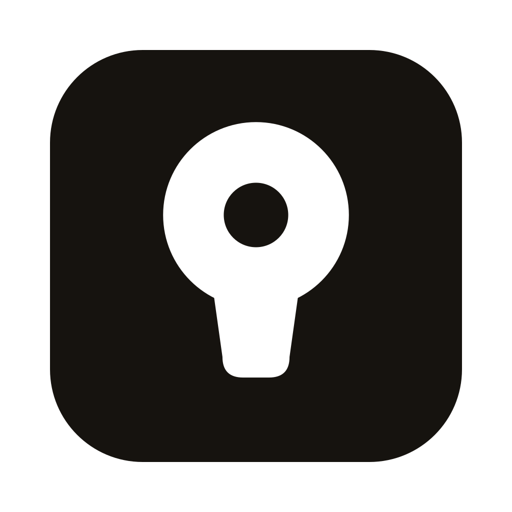

# Enclave brand

The mark is a **keyhole**:

- a round head with the pin punched through it;
- a stem that tapers and stops;
- all of it one flat shape in one colour, on a 24-unit grid.

An *enclave* is a territory enclosed inside another — a region that answers to itself. A keyhole is the way into one. The mark shows what the app is: a private place only your key opens.

The wordmark is `ENCLAVE`, **constructed on a cell grid** — the initial **E at full cap height, the remaining letters as small caps** — and sliced by two horizontal rules. It is built from plain rectangles, never typeset: no asset in this directory contains a `<text>` element or a `font-family`, so nothing about the brand can render wrong because a reader lacks a font.

## Files

| File | What it is | Use it for |
|---|---|---|
| [`logo.svg`](logo.svg) | White mark on an ink tile, on Apple's icon grid (824 px in 1024) | The app-icon source |
| [`logo-tile.svg`](logo-tile.svg) | The tile, edge to edge | Favicons |
| [`mark.svg`](mark.svg) | The keyhole alone, in `currentColor` | Anywhere text could go |
| [`lockup.svg`](lockup.svg), [`lockup-dark.svg`](lockup-dark.svg) | The tile beside the wordmark, for light and for dark pages; on dark pages the tile turns to paper | The README and the website |
| [`icon-foreground.svg`](icon-foreground.svg), [`icon-background.svg`](icon-background.svg) | The Android adaptive-icon layers: the keyhole alone at 62 % of the canvas (inside Android's 66/108 safe zone, so no launcher mask clips it), and solid ink behind it | `scripts/generate-icons.mjs` |
| [`social-preview.png`](social-preview.png) | A 1280×640 card for links to the repository | GitHub → Settings → Social preview |

Every file above was generated from one set of numbers, recorded below so the assets can be rebuilt or hand-corrected. **Their generator is not committed yet** — the numbers are the source of truth in the meantime.

`scripts/generate-icons.mjs` derives every platform icon from these files by handing them to `tauri icon`, which does the rasterising and writes `.ico`/`.icns` correctly. The geometry therefore lives here and nowhere else. It replaced `scripts/generate-icons.py`, which redrew the mark from scratch with Pillow — a second, hand-synced copy — and wrote the Android icons into `src-tauri/gen/android`, a path the repository restructure left behind, so Android had silently stopped receiving icons.

### The mark — a 24 grid

| Part | Shape |
|---|---|
| Head | circle, centre (12, 9), radius 7.2 |
| Pin | circle, centre (12, 9), radius 2.5, cut out of the head as a real hole |
| Stem | top at y 13.6, bottom at y 21.6, width 7.0 → 5.2, bottom corners radius 1.6 |

The mark is tall and narrow, so on a tile it is scaled to 62 % of the tile's height and lifted 1.5 % of the tile, which stops the stem from making the whole thing look bottom-heavy.

### The wordmark — a cell grid, with small caps

| Part | Value |
|---|---|
| Cell | 5 wide; the grid is the unit of every letter |
| Initial **E** | 5 × 7 cells — full cap height |
| **NCLAVE** | 5 × 5 cells — small caps, the same 1-cell stroke, sitting on the same baseline |
| Gap | 1 cell between letters (advance 6) |
| Slice | the top 32 % of the cells in rows 3 and 5 of the 7-row cap box |
| In a lockup | cell = tile height ÷ 7, so the wordmark's height always equals the tile |

The small caps are **drawn for the smaller box**, not a scaled-down copy of the 7-row forms: scaling would produce fractional cell widths and break the grid. Every stroke in the wordmark is exactly one cell, in both sizes.

The slice rows are **absolute** positions in the 7-row cap box, not per-letter rows. They have to be, or the rule would sit at a different height over the E than over the small caps and the line would break.

The slice is applied **only where a stroke exists**, never across the gaps between letters. Drawing it as one rule spanning the whole word would read as a stripe laid over the type rather than a property of the letters.

If the generator is committed later, it takes these numbers as its only input — change them in one place and every asset above follows.

## Colour

| Name | Value | Where |
|---|---|---|
| Ink | `#16130F` | The tile, and the mark on light ground. The same value as the app's `--color-bg` |
| Paper | `#FFFFFF` | The mark on the tile |
| Paper (dark pages) | `#F4F1EA` | The tile and the wordmark on dark pages |

The identity is monochrome and takes no colour of its own. In the app the mark follows the theme; the interface keeps its one accent for actions, and that accent is never applied to the mark.

## Type

The wordmark is **not a font** — it is geometry, and it can never be re-typed. Running text is Inter (SIL Open Font License), which the app bundles so text is identical on every machine.

## Do and don't

- Keep clear space around the lockup of at least half the tile's width.
- Keep the pin: it is the whole difference between a keyhole and a balloon.
- Keep the small caps: the initial is full height and the rest are not. Setting the whole word at one height throws away the only typographic idea in it.
- Don't add gradients, shadows or outlines. Don't rotate the mark, recolour it, or outline the wordmark.
- At 16 px use the tile, not the bare mark.
- Don't set the wordmark below ~40 px, and never re-type it — it exists only as these outlines.

## The slice — settled

The slice and the small caps are two devices doing adjacent work, and now that the small caps carry the typographic interest the slice is doing less. Removing it entirely was considered, and it does look cleaner.

It is **kept**: it was chosen deliberately, every user meeting the brand sees it as the wordmark's most recognisable detail, and it costs nothing to reverse — dropping it is `CUT_ROWS = []` in the generator.

## What this replaced

- **An un-punched keyhole.** Without the pin the shape reads as a light bulb or a balloon. The pin is the entire fix.
- **A sliced mark.** Cutting the keyhole with the wordmark's rule was tried and rejected: it turns the mark into a light bulb with a filament.
- **A ring/boundary family** (ring + node, ring + dot, ring + pair, open gate), tested at 14–20 px and rejected — every variant collapses into a camera lens or a target.
- **An outlined Inter wordmark**, briefly generated while bringing the mark up to standard. It was a mistake: the wordmark had already been chosen, and replacing it discarded a decision rather than improving it. The grid wordmark is the one that stays.
- **All-cap wordmark.** Every letter used to be 5 × 7. Only the E is now at full height; the rest are small caps.

The name and the tagline *Knowledge that stays yours.* carry over unchanged.
