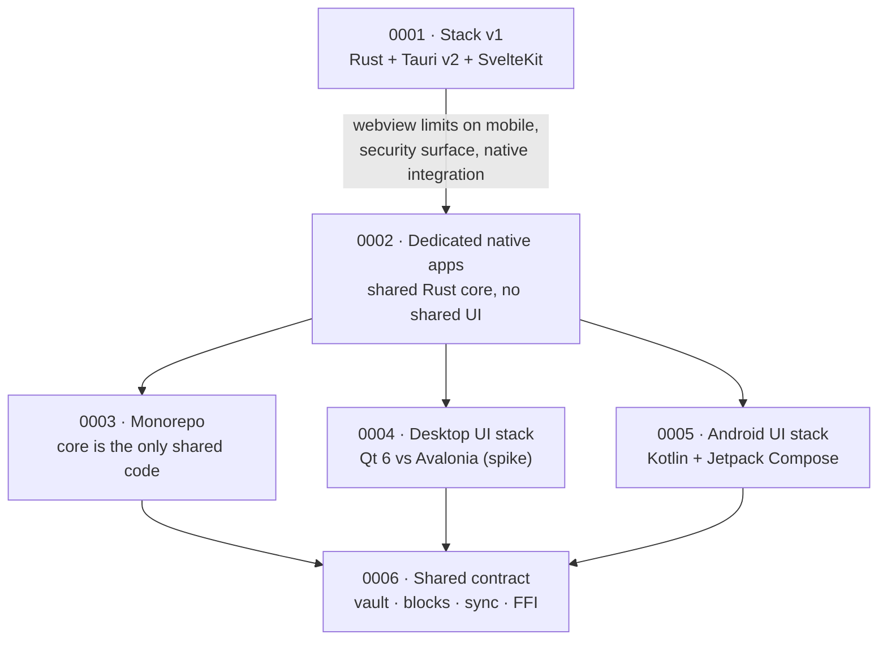

# Decision records

This directory is the project's long-form memory: **what we chose, why, what we tried before, what broke, and why we changed.**

`CHANGELOG.md` records what shipped to users. An Architecture Decision Record (ADR) records *why the product is built this way* and whether that reasoning still holds. `docs/HISTORY.md` is the timeline that ties the two together.

## Rules

- One decision per file, named `NNNN-short-title.md`. Numbers are assigned once and are never reused or renumbered.
- Status is one of `Proposed`, `Accepted`, `Rejected`, `Deprecated`, `Superseded by NNNN`.
- To change a decision, **add a new ADR** that supersedes it. Set the old record's status to `Superseded by NNNN`; never delete or rewrite it.
- Write for a reader who joins in two years: context, the decision, consequences (including the bad ones), the alternatives and why they lost.
- When a decision is revisited, say explicitly what was wrong with the previous choice.
- Security-relevant decisions (crypto, storage, sync transport, update verification) also update `SECURITY.md` where behaviour changes.

## Index

| ADR | Title | Status | Area |
| --- | --- | --- | --- |
| [0001](0001-stack-v1-rust-core-tauri-sveltekit.md) | Stack v1: Rust core + Tauri v2 + SvelteKit | Accepted (to be superseded by 0002) | Stack |
| [0002](0002-dedicated-native-apps.md) | Dedicated native apps with a shared Rust core | Accepted (execution gated by Phase 0 spike) | Architecture |
| [0003](0003-monorepo-core-boundary.md) | Monorepo with the core as the only shared code | Accepted | Repository |
| [0004](0004-desktop-ui-stack.md) | Desktop UI stack | Proposed — decision gate: editor spike | Stack |
| [0005](0005-android-ui-stack.md) | Android UI stack: Kotlin + Jetpack Compose | Accepted | Stack |
| [0006](0006-shared-contract-versioning.md) | Shared contract: vault, block schema, sync protocol, FFI | Accepted | Compatibility |

## Decision map

## Adding a record

1. Pick the next number and copy `template.md`.
2. Fill in context, decision, consequences, alternatives, and prior art.
3. Add a row to the index above and update the map if the decision changes relationships.
4. Add a row to `docs/HISTORY.md`.
5. If it supersedes an ADR, update that ADR's status and the `Superseded by` field.
