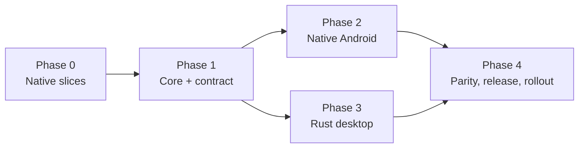

# Plan: native desktop + Android apps on one Rust core

Companion to ADR 0002 and ADR 0014. This is the execution plan for the native-only repository: two dedicated apps that share no UI code, both built on the versioned Rust core.

## Status

Live tracker: [`docs/STATUS.md`](../STATUS.md). Desktop feature migration: [`desktop-feature-parity.md`](desktop-feature-parity.md).

- **Phase 0** — complete enough to proceed: the Android vertical slice works; the Rust desktop editor slice is built (fixture round-trip, editing, marks, tasks, split/merge, undo/redo, autosave); IME and accessibility are the remaining gate.
- **Phase 1** — complete: vault schema versioning, block golden fixture, sync-frame fixtures and [`docs/CONTRACT.md`](../CONTRACT.md).
- **Phase 2** — native Android is feature-complete for a first release; the remaining real-device checklist is #188.
- **Phase 3** — Rust desktop editor prototype is in progress.
- **Phase 4** — native release pipelines and parity/rollout are not started ([#241](https://github.com/Pranesh-Selvaraj/Enclave/issues/241)).

## Goal

Ship a native Rust desktop and a native Android app that share no UI code, both built on the same Rust core, with identical vaults and a wire-compatible sync protocol. Remove the browser engine and the retired Tauri/Svelte shell from `main`.

## Invariants

- The Rust core (`core-db`, `core-network`, `core-api`) is the only implementation of crypto, storage, the block schema and sync.
- The contract in ADR 0006 is versioned and tested; desktop and Android must interoperate.
- No cloud, accounts or telemetry.
- A Tauri-created vault (schema v1 / protocol v3) must still open in both native apps; the Tauri app is a historical peer, not a build target.
- No C ABI on desktop; Android keeps UniFFI.
- No webview or shared UI framework.

## Non-goals

- A shared UI framework or shared components between desktop and Android.
- iOS is on the roadmap as a future native app on the same core and contract, but it is not part of the current milestone.
- Rewriting the vault, crypto or sync protocol.
- Keeping a buildable Tauri/Svelte app on `main`.

## Phases

Phases are criteria-driven, not calendar-driven.

### Phase 0 — Native slices

**Delivered**

- Android slice: Compose + `core-api` via UniFFI, vault, notes, editor, sync service and widget.
- Rust desktop slice: vault gate, notes list, editable text/tasks/marks, save/autosave and the canonical fixture round-trip.
- Contract fixtures as the interop gate.

**Remaining exit criteria**

- Rust desktop: real IME, AccessKit/screen-reader pass, table/list polish, 2,000-block latency.
- Android: the remaining real-device checklist (#188).

### Phase 1 — Core and contract

**Delivered**

- Core in `core/` per ADR 0003.
- UniFFI for Android and a direct Rust crate for desktop; no C ABI.
- Vault schema v1, block JSON v1, sync protocol v3 and golden fixtures.
- Compatibility matrix and [`docs/CONTRACT.md`](../CONTRACT.md).

**Remaining**

- App-side interop CI: native Android + Rust desktop against one core SHA and the fixtures, including a Tauri-created vault fixture.
- Sync protocol v4 (deltas, compression, attachments, settings/templates, resumable transfers).

### Phase 2 — Native Android app

**Delivered**

- Compose app: gate, notes layouts, sort/search, folders, tags, editor, settings, sync screen.
- Widgets (notes list, pinned note, quick capture), Quick Settings tile, launcher shortcuts, share target.
- Foreground sync service, Keystore-wrapped widget cache, SAF backup/restore, update check.
- Device pass on Nothing A063 for the gate, share target, export, restore and update check.

**Exit criteria**

- The remaining hardware checklist (#188): widgets + interactive checklist, Quick Settings tile, background sync to the desktop, TalkBack, release-signed update install.
- Published parity checklist for the native Android surface.

### Phase 3 — Rust desktop app

**Delivered**

- eframe/egui shell: vault gate, notes list, note composer, editable document view, mark toolbar, autosave/save/lock.
- Headless engine: ProseMirror model/validation, selection, transactions, history, marks, tasks, block split/merge, table-cell text editing.
- Direct `core-api` worker; no FFI. Save/load through the core.
- 19 tests, including a headless render of the canonical fixture.

**Next**

- IME, AccessKit and keyboard-only pass; 2,000-block latency.
- Home/organisation (#236), editor/data blocks (#237), whiteboard/graph/split/palette (#238), AI/sync UI (#239), settings/platform/accessibility (#240).
- Packaging, signing and verified updates ([#241](https://github.com/Pranesh-Selvaraj/Enclave/issues/241)).

**Exit criteria**

- [Desktop feature parity](desktop-feature-parity.md) is green.
- Screen-reader and keyboard-only passes; IME across CJK/combining sequences.
- Signed installers and verified updates on Linux, Windows and macOS.
- No C ABI, no C++ and no webview.

### Phase 4 — Parity, release and rollout

**Deliverables**

- Native Android release pipeline: release build from `apps/android`, APK/AAB signing, Ed25519 update signatures, GitHub release upload.
- Rust desktop packaging/update pipeline: `.deb`/`.AppImage`, `.msi`/NSIS, `.dmg`, signing/notarisation and verified updates.
- Interop CI: native Android ↔ Rust desktop ↔ historical Tauri vault fixtures.
- Parity checklist green for both apps; historical Tauri code remains in tags only.

**Exit criteria**

- Both native apps ship signed releases from `main`.
- A Tauri-created vault opens in both native apps and syncs with a native peer.
- No Tauri/Svelte code is required to build or release the product.
- No browser engine ships.

## Risks and mitigations

| Risk | Impact | Mitigation |
| --- | --- | --- |
| Rust editor engine proves larger than planned | Highest — blocks desktop parity | Fixture/IME/accessibility gate before the shell grows; engine is its own submodule; `canvist` is a reference, not a dependency. |
| Contract drift between apps | Sync breakage, data loss | ADR 0006: versioned surfaces, golden fixtures, interop CI against one core SHA. |
| Native release gap after Tauri retirement | No new installers until #241 lands | Existing Tauri releases remain; prioritize Android signing and desktop packaging; releases pause rather than publish unsigned. |
| Vault migration failure | Data loss | Migrations tested against canonical fixtures from every released version. |
| Parity gap (whiteboard, graph, database, AI) | Desktop feels incomplete | Publish the parity checklist; do not call the desktop the product until green; ship it as a prototype internally. |
| Android background/battery restrictions | Sync reliability | Foreground service with visible state; measure on real devices. |
| Accessibility/IME regressions | Users blocked | Gate before declaring the editor usable; test with real input methods and screen readers. |

## Success criteria

- Native Android and Rust desktop pass their parity checklists and ship signed releases.
- A Tauri v1.15.0 vault opens in both native apps and syncs with a native peer.
- `main` builds and releases with no Tauri/Svelte/Node UI toolchain.
- Cross-device sync is proven by CI interop tests.
- No browser engine, no C ABI and no C++ in the product.
