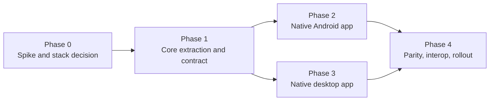

# Plan: dedicated native desktop + Android apps

Companion to ADR 0002. This is the execution plan for moving Enclave from the shared-web-UI architecture (ADR 0001) to two dedicated native apps on one versioned Rust core.

## Status

Live tracker: [`docs/STATUS.md`](../STATUS.md).

- **Phase 0** — the Android vertical slice is built; the desktop stack is parked (ADR 0004 *Proposed*, PR #177 unmerged) and Qt is unverified on the current machine.
- **Phase 1** — vault schema versioning and the block golden fixture are in; sync-frame fixtures and the contract document remain.
- **Phase 2** — the native Android app is feature-complete for a first release; the hardware pass is pending.
- **Phase 3/4** — not started (desktop).

## Goal

Ship a native Android app and a native desktop app that share no UI code, both built on the existing Rust core, with identical vaults and a wire-compatible sync protocol. Remove the webview from the shipping product.

## Invariants (must never change)

- The Rust core (`core-db`, `core-network`, `core-api`) is the only implementation of crypto, storage, the block schema and sync.
- The contract in ADR 0006 is versioned and tested; desktop and Android must always interoperate.
- No cloud, no accounts, no telemetry: the product's mission is unchanged.
- Users' existing vaults open in every new app; migrations are one-way and tested.

## Non-goals

- A shared UI framework or shared components between desktop and Android.
- iOS (the contract must not preclude it, but it is not in this plan).
- Rewriting the vault, crypto or sync protocol. The core is reused; the UI is replaced.

## Phases

Phases are criteria-driven, not calendar-driven: a phase ends when its exit criteria are met, and the next begins as soon as its dependencies are complete.

### Phase 0 — Spike and stack decision

**Deliverables**

- A block-editor prototype in each leading desktop candidate (Qt 6 and Avalonia, per ADR 0004) covering: paragraphs, headings, lists, tables, images, code blocks, undo/redo, IME, keyboard navigation, Markdown paste, and a screen-reader pass.
- A Rust-interop proof for each candidate (C ABI / bindings), plus packaging, signing and auto-update on Windows/macOS/Linux.
- An Android vertical slice: Compose app + `core-api` via UniFFI, opening a vault, listing notes, editing one document, and running background sync through a foreground service; one Glance widget.
- A written measurement table: build time, binary size, cold start, editor latency, memory, and developer effort per candidate.

**Exit criteria**

- ADR 0004 is superseded by an `Accepted` record naming the desktop stack, with the prototype evidence.
- The editor prototype meets a minimum usability bar (typing latency, IME, tables) on the chosen stack.
- The Android slice proves the UniFFI path end to end on a real device.
- The contract tests exist as a skeleton (vault fixture, one sync frame fixture).

### Phase 1 — Core extraction and contract

**Deliverables**

- Core moved to `core/` per ADR 0003, with the current Tauri app still building and shipping.
- A stable FFI surface in `core-api`: UniFFI bindings for Kotlin, and a C ABI for the desktop stack.
- An explicit vault schema version and ordered migration chain (ADR 0006).
- Golden fixtures and interop tests: canonical vault, block-schema documents, sync frames; both app stacks build against the same core SHA.
- The compatibility matrix (app ↔ core ↔ protocol ↔ schema) published in `docs/`.

**Exit criteria**

- `cargo test` plus interop fixtures pass for core + both app stubs.
- The Tauri app still reads and writes the same vaults, unchanged, against the new core layout.
- Contract documentation is complete enough for an app developer to build against without reading core internals.

### Phase 2 — Native Android app

**Deliverables**

- Compose app: unlock/create vault, notes layouts (List, Gallery, Cards, Icons), sort, search, folders, tags, editor (the Phase 0 prototype hardened), settings, sync UI.
- Native integration: foreground sync service, Glance widgets (notes list, pinned note, quick capture), share target, launcher shortcuts, Quick Settings tile, Keystore-backed widget cache, SAF import/export/backup, insets.
- Migrate an existing v1.13.0 vault without data loss; sync against the current Tauri app.

**Exit criteria**

- Feature parity with the current Android build of the Tauri app on a published checklist.
- Background sync survives restart and screen-off on a real device; battery measurements recorded.
- TalkBack pass on primary flows; widgets render while locked.

### Phase 3 — Native desktop app (can run alongside Phase 2 once Phase 1 is complete)

**Deliverables**

- Native shell: vault flow, sidebar and folder tree, editor, whiteboard, database views, graph, split view, command palette, settings, tray/wallpaper widget, updates.
- Platform integration per OS: menus, file dialogs, drag-and-drop, notifications, global shortcuts, signing/notarisation, installers (`.deb`/`.AppImage`, `.msi`/NSIS, `.dmg`).
- Migration of an existing vault; sync against both the Tauri app and the native Android app.

**Exit criteria**

- Feature parity with the desktop Tauri app on a published checklist.
- Screen-reader pass on primary flows; keyboard-only navigation works.
- Auto-update path verified on all three OSes, including signature verification.

### Phase 4 — Parity, interoperability, rollout

**Deliverables**

- Cross-app interop matrix run in CI: Tauri ↔ native Android ↔ native desktop, all combinations, for the sync protocol and vault format.
- Release pipelines for both native apps (signing, versioning, changelog, release notes).
- Rollout: native apps ship alongside Tauri; Tauri is deprecated and then removed once telemetry-free crash/issue reports show parity.

## Risks and mitigations

| Risk | Impact | Mitigation |
| --- | --- | --- |
| Editor rebuild proves larger than planned | Highest — blocks both apps | Phase 0 prototype with a hard go/no-go; treat the editor as its own subproject with its own milestones. |
| Contract drift between apps | Sync breakage, data loss | ADR 0006: versioned surfaces, golden fixtures, interop CI against one core SHA. |
| Desktop stack choice is wrong | Costly rework | Spike both candidates before committing; record evidence in the ADR. |
| Vault migration failure | Data loss | One-way migrations tested against canonical fixtures from every released version; never ship a migration without a round-trip test. |
| Parity gap (whiteboard, graph, database) | Native apps feel incomplete | Publish a parity checklist per app; do not deprecate Tauri until it is fully green. |
| Three apps during transition | Maintenance load, confusion | Bound the transition by parity criteria; keep `main` as the source of truth and release Tauri from its own tags. |
| Android background/battery restrictions | Sync reliability | Foreground service with visible state; measure on real devices; fall back to manual sync when restricted. |
| C++/new-language risk (if Qt) | Velocity | Confine non-Rust code to presentation; keep the FFI boundary small and typed. |

## Success criteria

- Native desktop and native Android apps pass parity checklists and ship signed releases.
- A v1.13.0 vault opens in both new apps and syncs with an unmodified Tauri app.
- The Tauri app can be retired with no loss of features or data.
- Cross-device sync is proven by CI interop tests, not by manual testing alone.
- No browser engine ships in the product.
